<!-- Header Banner -->

  

<!-- Introduction -->

  <h1>👋 Hi, I'm Yasir Raees</h1>
  <h3>Software Engineer | Full-Stack & AI Systems Architect</h3>
  
<b>Passionate Developer from Lahore, Pakistan 🇵🇰</b>

  
  
  
  
  
  

 

<!-- GitHub Snake -->

  

 

<!-- Technologies -->

  <h2>💻 Tech Stack</h2>
  
  #### Languages & Frameworks
  
  
  #### Frontend & Mobile
  
  
  #### Databases & Caching
  

    
    
    
  

  
  #### Tools & Platforms
  

 

<!-- Featured Projects -->

  <h2>🚀 Featured Projects</h2>
  
  <table>
    <tr>
      <td align="center" width="50%">
        
      </td>
      <td align="center" width="50%">
        
      </td>
    </tr>
    <tr>
      <td align="center" width="50%">
        
      </td>
      <td align="center" width="50%">
        <a href="https://innovent.io/pages/platform.html" target="_blank">
            
          <b>📡 Innfini IoT & RFID Platform</b> 
          Reduced audit cycle times by 45%
        </a>
      </td>
    </tr>
  </table>

 

<!-- Social Media -->

  <h2>🌐 Connect With Me</h2>
  
  
  
  
  

 

<!-- How to collaborate -->

  <h2>🤝 How to Collaborate</h2>
  
  🔍 Explore my open-source repositories 
  🐛 Report issues or suggest improvements 
  💡 Discuss scalable SaaS architectures & AI agent workflows 
  🌟 Star the repositories you find helpful

 

<!-- Languages -->

  <h2>🌍 Languages</h2>
  
  
  

 

<!-- GitHub Stats -->

  <h2>📊 GitHub Stats</h2>
  
  
    
  
    
  

 

<!-- Footer -->

  
🤝 Open to collaborations, full-stack engineering roles & disruptive AI initiatives

  Built with ⚡ by <b>Yasir Raees</b>

